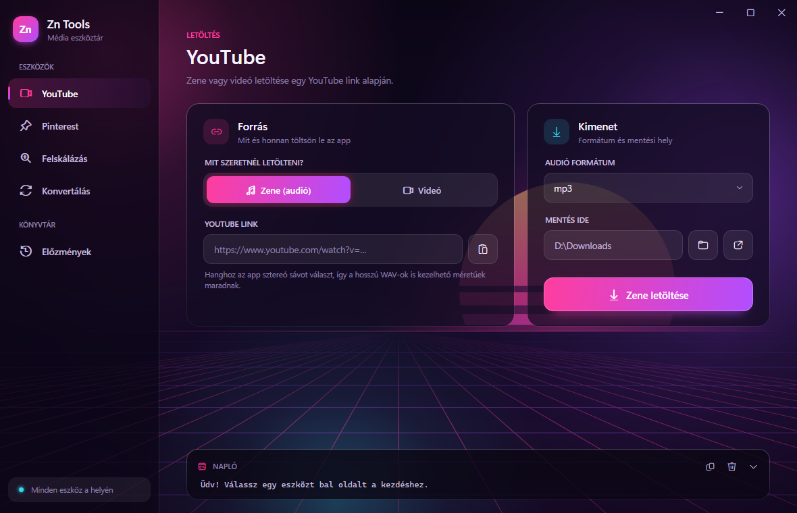
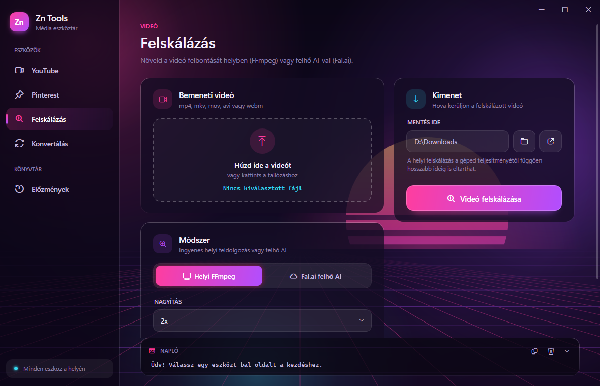
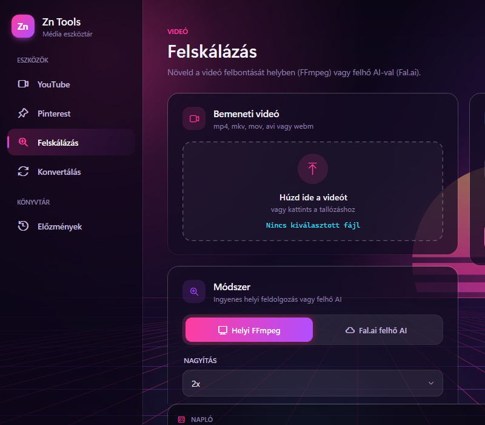

# Zn Tools

A **WPF (.NET 8)** desktop media toolkit for Windows. It downloads music and video from **YouTube** and **Pinterest**, **converts** between audio, video and image formats, **upscales video** locally (FFmpeg) or with cloud AI (Fal.ai), and keeps a **history** of every download. The interface is in Hungarian and uses a responsive "synthwave glass" design.




| Upscaling page | Narrow window: icon rail, stacked cards |
| --- | --- |
|  |  |

## Features

The sidebar has five sections (UI labels in Hungarian in brackets):

| Section | What it does |
| --- | --- |
| **YouTube** | Download **music** (`mp3` / `m4a` / `wav`) or **video** (best, 1080p, 720p, 480p, 360p, merged to `mp4`). For audio it picks a stereo track: YouTube's "best" audio is often 5.1, which would turn a long video into a WAV past the 4 GB limit. RF64 covers WAVs that would still go over 4 GB. The log shows exactly where the file was saved. |
| **Pinterest** | Download the video of a Pin (`mp4` or original quality). |
| **Upscaling** *(Felskálázás)* | **Local:** FFmpeg 2× / 3× / 4× with Lanczos, xBR or Bicubic. The output is H.264 in 4:2:0 colour that every player opens; `webm`/`avi` inputs come out as `mp4`. **Cloud:** Fal.ai models with your own API key. |
| **Converter** *(Konvertálás)* | 15 target formats: `mp3 wav aac flac ogg`, `mp4 mkv mov avi webm`, `png jpg gif bmp ico`. ffprobe checks what is inside the input, and only compatible targets become active (see below). |
| **History** *(Előzmények)* | Every YouTube / Pinterest download with time, source, format and the exact saved file. You can show it in Explorer, copy the link or remove the entry. Stored in `%LOCALAPPDATA%\ZnTools\download-history.json`. |

**Converter compatibility.** Nothing is active until you pick a file. After that:

| Input | Offered targets |
| --- | --- |
| Audio (also mp3/m4a with album art) | audio formats |
| Video with sound | video formats, the soundtrack as audio, animated GIF |
| Video without sound | video formats, animated GIF |
| Image | image formats |
| Animated GIF | image formats (first frame) and video formats |
| Anything FFmpeg can't read | nothing; the app says why |

Audio targets always contain sound only. Video targets are always even-sized 4:2:0, so a GIF → MP4 plays everywhere.

### Interface

- **Responsive layout:**
  - The sidebar folds into an icon rail below ~1040 px (labels show as tooltips).
  - The cards reflow from two columns to one.
  - Margins and the log shrink on small windows.
- **Abstract animated backdrop** (drifting neon light, a sliced sun, a perspective grid). It pauses while the window is minimised and is off when Windows animations are turned off.
- **File input:** drag-and-drop zones, plus paste-from-clipboard and "open folder" buttons.
- **Log:** live progress line; you can select, copy and collapse the log.
- **Tools status:** a sidebar indicator shows whether `yt-dlp`, `ffmpeg`, `ffprobe` and `deno` are in place.
- **Downloads folder:** files go to your real Windows Downloads folder by default, even if it has been moved off `C:`.
- **Window:** custom frameless window (drag, snap, resize) with native rounded corners on Windows 11.

### Safety

- **Links:** a link must be a single `http(s)://` address with no spaces or quotes.
- **Tool arguments:** every external tool gets a separate argument list. Pasted text can never inject extra yt-dlp/FFmpeg options (such as `--exec`).
- **No overwriting:** conversions and upscales never overwrite an existing file. They write `name (1).ext` instead.
- **Closing during a job:** the app asks first, then stops the tool and its child processes. They don't keep running in the background.
- **Cloud upscaling** uploads the video to **tmpfiles.org** (max 100 MB). Anyone with the link can download it for about 60 minutes. The UI says this up front; use local upscaling for personal videos. The API key is sent only to Fal.ai, never to the file host.

## Tech stack

- **C# 12 / .NET 8** (`net8.0-windows`), **WPF**:
  - custom control templates and `WindowChrome`;
  - a small responsive panel (`AdaptiveColumnsPanel`);
  - storyboard animations.
- **[yt-dlp](https://github.com/yt-dlp/yt-dlp)** with **[deno](https://deno.com/)** as its sandboxed JavaScript runtime: YouTube and Pinterest downloads.
- **[FFmpeg / ffprobe](https://ffmpeg.org/)**: conversion, media inspection, local upscaling.
- **[Fal.ai](https://fal.ai/)** queue API via `HttpClient` / `System.Text.Json`: cloud AI upscaling.

## Getting started

### Prerequisites

- Windows 10 / 11
- [.NET 8 SDK](https://dotnet.microsoft.com/download/dotnet/8.0)
- `yt-dlp.exe`, `deno.exe`, `ffmpeg.exe` and `ffprobe.exe`.
  - They are **not** in the repository: they are large binaries with their own licenses.
  - The app looks for them next to its executable (`bin/Debug/net8.0-windows/`).
  - `fetch-tools.ps1` downloads them for you.

### Build & run

```bash
git clone https://github.com/HMarcell94/Zn.git
cd Zn
```

Fetch the tools into the build output folder (needs only PowerShell):

```powershell
./fetch-tools.ps1
```

If PowerShell refuses to run scripts, this allows it for this one run only:

```powershell
powershell -ExecutionPolicy Bypass -File .\fetch-tools.ps1
```

Then build and run:

```bash
dotnet run --project ZnDownloader.csproj
```

> **What `fetch-tools.ps1` does**
>
> - Downloads each tool from its official release location over HTTPS.
> - Checks it against the published SHA-256 checksum **before** extracting or installing it. A mismatch stops the script and installs nothing.
> - Updates an existing `yt-dlp.exe` in place (`yt-dlp -U`) and skips the other tools if they are already there.
> - `-Force` re-downloads everything; `-OutputDir bin/Release/net8.0-windows` targets a Release build.
>
> The app also runs `yt-dlp -U` once per session before the first download.

To install the tools by hand instead: [yt-dlp](https://github.com/yt-dlp/yt-dlp/releases), [deno](https://github.com/denoland/deno/releases), [FFmpeg](https://www.gyan.dev/ffmpeg/builds/) (the "release essentials" build contains both `ffmpeg.exe` and `ffprobe.exe`).

### Cloud upscaling (optional)

1. Get a free API key (no credit card required) from [fal.ai](https://fal.ai/).
2. In **Felskálázás**, choose **Fal.ai felhő AI** and paste the key. It is never stored or committed.

Mind the tmpfiles.org note under [Safety](#safety).

## Troubleshooting

| Symptom | Cause and fix |
| --- | --- |
| `HTTP Error 403: Forbidden`, "SABR streaming" or "No supported JavaScript runtime" warnings | yt-dlp is outdated or `deno.exe` is missing. Run `fetch-tools.ps1`; the sidebar indicator turns cyan when every tool is in place. |
| "Sign in to confirm you're not a bot" | YouTube is rate-limiting your IP, usually after many downloads in a short time. Wait a few hours and try again. |
| A target format is greyed out in the converter | It doesn't fit the chosen input (e.g. a video can't become a `png`). The hint above the format buttons says what the file can become. |

## Project structure

```
ZnDownloader.csproj   # .NET 8 WPF project
App.xaml(.cs)         # Entry point + global crash logging
MainWindow.xaml       # UI: design tokens, styles, abstract backdrop, sidebar, card pages
MainWindow.xaml.cs    # Logic: downloads, conversion, upscaling, history, responsive layout
Ui.cs                 # Attached properties + AdaptiveColumnsPanel (responsive card layout)
DownloadHistory.cs    # Download history model + JSON store (%LOCALAPPDATA%\ZnTools)
fetch-tools.ps1       # Downloads and checksum-verifies yt-dlp / deno / ffmpeg / ffprobe
docs/                 # README screenshots
icon.ico              # App icon
hatterkep.png         # Previous background photo (no longer used by the UI)
```

## Disclaimer

This project is for personal and educational use. Respect the Terms of Service and copyright of any platform you download from, and only download content you have the right to.

## License

Released under the [MIT License](LICENSE).
